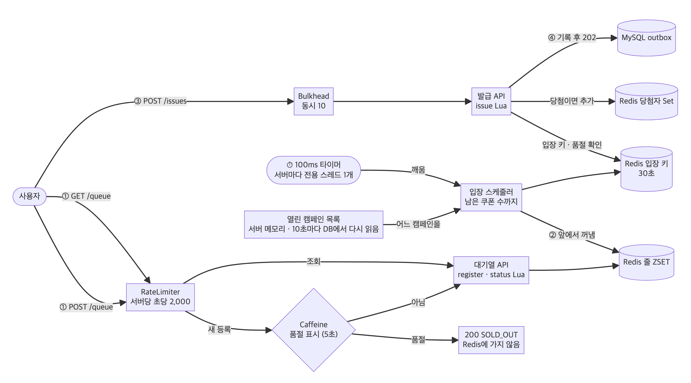
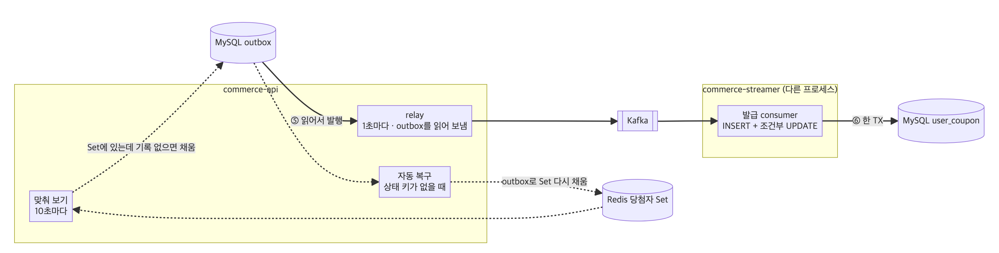

## 1. 개요
- 선착순 쿠폰 발급을 Redis 대기열(Sorted Set)과 Lua 판정, Kafka 비동기 발급으로 구현.
- 멀티 인스턴스 환경에서 줄 순서대로, 쿠폰 수만큼만 발급된다.

## 2. 배경
- 선착순 발급에서 지켜야 할 것은 세 가지다.
  - 쿠폰 수보다 많이 발급하지 않는다.
  - 한 사람은 한 번만 받는다.
  - 먼저 온 사람이 먼저 받는다.
- 이벤트 시작 순간에 요청이 몰린다. 서버는 여러 대이고, 쿠폰 DB는 주문·상품 API와 같은 MySQL을 쓴다.

## 3. 구현 상세

### (1) 대기열 등록 — `POST /queue`
- 대기열은 Redis Sorted Set 하나로 구성했다. member는 userId, score는 Lua 안에서 `INCR`한 순번이다.
  - 굳이 timestamp를 쓰지 않은 이유: 서버마다 시계가 다르고, 같은 시각이 겹칠 수 있다.
- 등록 Lua는 아래 순서로 확인한다.
  1. 이미 당첨된 사람 → 당첨 응답
  2. 품절 → 품절 응답
  3. 입장 중인 사람 → 입장 응답
  4. 이미 줄에 있는 사람 → 원래 자리 (다시 눌러도 뒤로 밀리지 않도록)
  5. 줄이 비어 있고 자리가 있음 → 바로 입장
  6. 줄이 가득 참 → 429 상태 응답
  7. 그 밖 → 줄에 넣는다

```lua
-- register.lua (일부)
local rank = redis.call('ZRANK', KEYS[3], ARGV[1])
if rank then
  return {'WAITING', rank}  -- 이미 줄에 있으면 원래 자리 그대로
end
-- ... (바로 입장, 줄 길이 제한)
local seq = redis.call('INCR', KEYS[4])
redis.call('ZADD', KEYS[3], seq, ARGV[1])
return {'WAITING', redis.call('ZRANK', KEYS[3], ARGV[1])}
```

- 품절 뒤에는 로컬 캐시(Caffeine, 5초)의 품절 표시를 보고 Redis까지 가지 않는다.

### (2) 입장 — 서버마다 100ms 스케줄러
- 모든 서버가 100ms마다 입장 Lua를 부른다.
- Lua는 Redis `TIME`으로 구간 번호를 구하고, 구간 카운터로 이번 구간에 몇 명 들였는지 센다.
  - 서버가 몇 대든 구간당 5명(초당 50명)만 들어간다.
- 받을 수 있는 사람 수 : `min(구간에 남은 수, 쿠폰 수 − 당첨자 − 입장 중인 사람)`
  - 해당 로직을 만든 이유 : 쿠폰 3장에 8명이 한꺼번에 입장해, 먼저 누른 사람이 받고 줄 1번이 못 받은 일이 있었다. 
  - 이제 줄 순서가 곧 당첨 순서다.
- 꺼낸 사람에게 30초짜리 입장 키를 준다. 꺼내기와 키 쓰기는 한 Lua 안에서 한다.

```lua
-- admit.lua (일부)
redis.call('ZREMRANGEBYSCORE', KEYS[4], '-inf', nowMs)  -- 입장하고 떠난 사람의 자리를 푼다
local remaining = tonumber(ARGV[1]) - winners - redis.call('ZCARD', KEYS[4])
local usedKey = ARGV[5] .. math.floor(nowMs / tonumber(ARGV[3]))  -- 이번 구간 카운터
local used = tonumber(redis.call('GET', usedKey) or '0')
local room = math.min(tonumber(ARGV[2]) - used, remaining)
-- ...
local popped = redis.call('ZPOPMIN', KEYS[3], room)
for i = 1, #popped, 2 do
  redis.call('SET', ARGV[6] .. popped[i], '1', 'EX', tonumber(ARGV[4]))  -- 입장 키
  redis.call('ZADD', KEYS[4], expiresAt, popped[i])                       -- 입장 기록
end
redis.call('INCRBY', usedKey, #popped / 2)
```

- 사용자는 `GET /queue`로 앞 인원을 본다. 다음 조회 간격은 서버가 정해 준다.

### (3) 발급 판정 — `POST /issues`
- 발급 Lua 한 번으로 확인하고 기록한다.

```lua
-- issue.lua
if redis.call('EXISTS', KEYS[1]) == 0 then
  return 'UNKNOWN'          -- Redis 데이터를 믿을 수 없다 → 복구
end
if redis.call('SISMEMBER', KEYS[2], ARGV[1]) == 1 then
  return 'ALREADY'          -- 이미 당첨
end
if redis.call('EXISTS', KEYS[3]) == 0 then
  return 'NOT_ADMITTED'     -- 입장 키 없음 → 409
end
if redis.call('SCARD', KEYS[2]) >= tonumber(ARGV[2]) then
  return 'SOLD_OUT'         -- 409
end
redis.call('SADD', KEYS[2], ARGV[1])
redis.call('ZREM', KEYS[4], ARGV[1])  -- "입장 중"에서 뺀다
return 'ACCEPTED'
```

- 당첨되면 DB outbox에 기록하고 202를 준다.
  - 응답 시점에는 아직 DB에 쿠폰이 없어서, 201이 아니라 202다.

### (4) DB 반영
- relay가 1초마다 outbox를 읽어 Kafka로 보낸다. 브로커가 받았다고 확인한 뒤에야 발행 완료로 표시한다.
- consumer(commerce-streamer)가 한 트랜잭션에서 사용자 쿠폰을 INSERT하고, 발급 수를 조건부 UPDATE로 올린다.

```java
@Query("UPDATE CampaignQuota c SET c.issuedCount = c.issuedCount + 1 "
     + "WHERE c.id = :id AND c.issuedCount < c.totalQuantity")
int increaseIssuedCountIfAvailable(@Param("id") Long id);
```

  - 0행이면(수량에 닿음) rollback한다.
  - 같은 메시지가 두 번 와도 UNIQUE(coupon_id, user_id)가 막는다.
- 10초마다 Redis 당첨자와 outbox를 맞춰 보고, 빠진 기록을 채운다.

### (5) 전체 프로세스 요약
1. 사용자가 줄에 선다 (`POST /queue`).
2. 서버들이 100ms마다 앞사람부터, 남은 쿠폰 수만큼 입장시킨다.
3. 사용자는 순번을 조회하다가, 입장하면 발급을 요청한다.
4. Lua가 당첨을 판정하고, outbox에 기록하고, 202를 준다.
5. relay → Kafka → consumer가 DB에 쿠폰을 만든다.

**요청 경로**



**DB 반영 (요청 뒤)**



## 4. 왜 대기열과 비동기 발급을 선택했는가

### (1) 대기열을 둔 이유
- 대기열 없이 발급 Lua만 두어도 수량과 중복은 지켜진다. 판정이 Lua 한 번이라 끼어들 틈이 없다.
- 하지만 순서는 지켜지지 않는다. 발급 요청이 Redis에 먼저 닿은 사람이 받는다.
- 몰리는 트래픽 양도 그대로 뒤로 간다. 시작 순간의 요청이 판정과 DB 기록까지 한꺼번에 몰릴 수 있다.
- 대기열은 순서와 양을 나눠 맡는다.
  - 도착 순서는 줄(`INCR` 순번)이 기록한다.
  - 뒤로 보내는 양은 입장 속도(초당 50명)가 정한다.
  - 자리가 없으면 실패가 아니라 기다림이다.
- 처음에는 입장 속도만 제한했다. 쿠폰 3장에 8명이 0.2초 안에 모두 입장했고, 발급을 먼저 누른 사람이 받았다. 그래서 1번이 못 받았다. 결론 : 남은 쿠폰 수만큼만 입장시키도록 고쳤다.
- **등록은 항상 대기열 API를 거친다.** 다만 앞에 아무도 없고 자리가 있으면 줄에 넣지 않고 바로 입장시킨다. 그래서 **대기 화면은 몰릴 때만 보인다.**

### (2) 왜 세마포어를 쓰지 않았나
- 세마포어(동시 처리 자리 3개)로 처리량을 제한하는 방식을 사용할 수도 있다.
- 세마포어는 자리가 없으면 거절한다. 쿠폰이 남아 있는데 실패하는 사람이 생긴다.
- 이 구조에서는 세마포어가 따로 지킬 것이 없었다. 그리고 Bulkhead와 RateLimit으로 구성하면 충분해보였다
  - 발급 API는 판정하고 202를 주고 끝난다. 스레드를 오래 붙잡지 않는다.
  - MySQL로 가는 양은 입장 속도와 consumer 동시 처리 수가 정한다.
  - 서버 한 대의 자원은 Bulkhead가 지킨다.
- 남는 효과는 "쿠폰을 받을 수 있는 사람도 자리가 없으면 거절"뿐이라서 뺐다.

### (3) 왜 바로 발급하지 않고 상태값 202를 주는가
- 바로 발급하면 요청 하나가 한 트랜잭션에서 사용자 쿠폰 INSERT(쿠폰 수만큼)와 발급 수 UPDATE를 한다.
- 이 MySQL과 커넥션 풀(40개, 모놀리스 방식)은 주문·상품 API와 같이 쓴다. 발급이 몰리면 주문 API도 커넥션을 기다린다.
- 그래서 요청 경로의 DB 일을 outbox INSERT 한 건으로 줄였다.
  - 당첨 판정은 Redis가 한다.
  - 무거운 쓰기는 consumer가 정해진 동시 처리 수로 나눠 한다.
- 응답 시점에는 쿠폰이 아직 DB에 없다. 그래서 201(생성)이 아니라 202(접수)다.
- DB와의 의존이 완전히 끊긴 것은 아니다. MySQL이 멈추면 outbox도 쓸 수 없어 새 당첨은 503이다.

### (4) 큐, Bulkhead, RateLimiter는 자원을 지킨다
- 이 서버는 모놀리스다. 쿠폰 API와 주문·결제 API가 같은 스레드, 같은 커넥션 풀, 같은 MySQL을 쓴다.
- 쿠폰 요청이 자원을 다 쓰면 결제 API가 기다린다. 그래서 세 군데서 양을 제한했다.

| 장치 | 지키는 것 | 넘치면 |
|---|---|---|
| RateLimiter (`/queue`, 서버당 초당 2,000) | 서버 한 대의 스레드와 CPU | 429로 거절 |
| Bulkhead (`/issues`, 동시 10) | 서버 한 대의 Tomcat 스레드와 커넥션 풀 | 503으로 거절 |
| 대기열 입장 속도 (전체 초당 50) | 모든 서버가 같이 쓰는 MySQL | 기다리게 함 |

- 셋 다 다른 API가 쓸 자원을 남긴다. 다른 점은 넘칠 때다. Bulkhead와 RateLimiter는 거절하고, 줄은 기다리게 한다.
- 그래서 줄은 자원을 지키는 장치이면서, 순서를 지키는 장치다.

## 5. 장점
- 줄에 들어있는 순서가 곧 당첨 순서다. 예외는 입장하고 발급하지 않은 사람뿐이다.
- 쿠폰이 남아 있으면 실패하지 않고 기다린다.
- 서버를 늘려도 입장 속도는 그대로다. 구간 카운터가 Redis에 하나라서다.
  - 테스트: 서버 4대가 같은 구간에 동시에 입장시켜도 3명만, 1·2·3번 순서로 들어왔다.
- 대기열 입장만 담당하는 메인 서버가 없다. 한 대가 죽어도 나머지가 입장을 이어 간다.
- MySQL로 가는 쓰기 속도를 입장 속도와 consumer 동시 처리 수가 정한다. 요청이 몰려도 주문 API와 커넥션을 다투는 양이 정해진 만큼으로 묶인다.
- 품절 뒤 요청은 서버 메모리에서 끝난다. Redis까지 가지 않는다.
- 수량은 두 번 지킨다. Redis가 먼저 막고, DB(조건부 UPDATE, UNIQUE)가 마지막에 막는다.
  - 테스트: 5자리에 8명 → 5명 발급, 3명 품절, `issued_count` 5. 같은 메시지가 두 번 와도 한 번만 발급.

## 6. 단점
- 입장하고 떠난 사람이 다음 사람을 최대 30초(입장 키 TTL) 늦춘다. 쿠폰이 거의 다 나갔을 때 마지막 몇 장이 늦게 나갈 수 있다.
- 202는 등록중이라는 접수 중 상태일 뿐이다. 쿠폰은 relay(1초로 구성)와 consumer를 거쳐 조금 뒤에 생긴다.
- MySQL이 멈추면 outbox를 쓸 수 없어 새 당첨은 503이다.
- **Redis가 일부 데이터만 잃으면 알아채지 못한다.**
  - 상태 키가 없으면 DB(outbox)로 다시 채운다. 하지만 상태 키가 남은 채 당첨자 일부만 사라지면(예: replica 승격) Redis는 정상으로 보고 더 많이 당첨시킨다.
  - 초과분은 DB 조건부 UPDATE가 막는다. 대신 202를 받은 사람이 쿠폰을 못 받는다.
- 초당 50명은 측정 전 임시값이다. 실제 트래픽을 받아보면서 조정이 필요하다
- 책임이 분리되었고, 각자의 책임이 커진만큼 각자의 역할이 중요해졌다. Redis, outbox relay, Kafka, consumer 앱이 모두 돌아야 쿠폰이 나간다.
